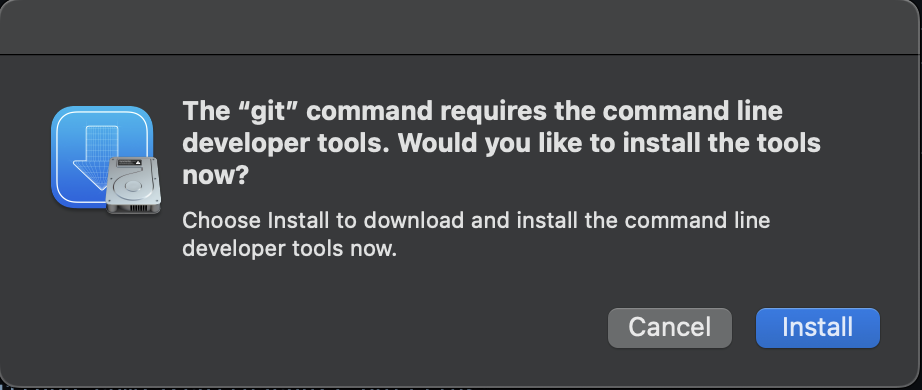

# :bookmark_tabs:

```text
     __          __       ___      ___
    /\ \        /\ \__  /'___\ __ /\_ \
    \_\ \    ___\ \ ,_\/\ \__//\_\\//\ \      __    ____
    /'_` \  / __`\ \ \/\ \ ,__\/\ \ \ \ \   /'__`\ /',__\
 __/\ \L\ \/\ \L\ \ \ \_\ \ \_/\ \ \ \_\ \_/\  __//\__, `\
/\_\ \___,_\ \____/\ \__\\ \_\  \ \_\/\____\ \____\/\____/
\/_/\/__,_ /\/___/  \/__/ \/_/   \/_/\/____/\/____/\/___/
```

### Spice up your Mac

Please follow these instructions to set up your Mac.

1. Run the following command to download the .dotfiles repo
   ```bash
   curl https://raw.githubusercontent.com/architeacher/.dotfiles/HEAD/scripts/download.sh | bash
   ```
    The script might be failing due to the missing command line developer tools installation, so please install it first, then run the script again.

    
2. Prerequisites
    We will use `make` for the installation to get help

   ```bash
   cd .dotfiles
   make
   ```
   This will provide help about the available targets.

3. Environment variables
   To create the `.envrc` file with variables that will be used in the installation, please run
   ```bash
   make .envrc
   ```

    This command will generate a `.envrc` file, that you can edit for your git username and email, it should look like this.
    ```dotenv
    # Installer
    FORCE_REINSTALL=false

    # Git
    GIT_EMAIL="john.doe@foo.bar"
    GIT_USER="John Doe"

    # Github
    GITHUB_USERNAME="john.doe"

    # Sginging Keys - make sure to escape $, in case of any.
    PASS_PHRASE="bottom.\$ecreT"

    # Installation profiles
    # The values can be one the following:
    # - private
    # - work
    PROFILE="private"
    ```

4. Installation
    Please check
    * [Brew](https://github.com/architeacher/.dotfiles/blob/main/stow/.config/homebrew/Brewfile "Brew file") file to select the software to install.
    * [.config](https://github.com/architeacher/.dotfiles/blob/main/stow/.config "Software config files") directory for the installed software that would be sym linked under `XDG_CONFIG_HOME:=~/.config` using GNU [Stow](https://www.gnu.org/software/stow/ "GNU Stow").

    To install, please run
    ```bash
    make install
    ```

5. Secrets
    Private config files live sops-encrypted in the `private/` submodule.
    After restoring your keys (step 6), decrypt them and enable the guard against plaintext commits once:
    ```bash
    make decrypt
    make hooks
    ```
    Edit the decrypted copies in `private/`, then run `make encrypt` before committing.

6. Key backups
    sops needs your gpg, age, YubiKey and ssh keys. Back them up, copy the archive to two offline media, and test it:
    ```bash
    make backup KEY="john.doe@foo.bar"   # writes a passphrase-protected archive
    make test-restore                    # checks the latest backup, changes nothing
    ```
    On a new Mac, `make restore` puts the keys back (`BACKUP_DIR=` to pick an older backup).
    `make docker-extract` rehearses the whole restore on a clean machine.
    See [docs/architecture.md](docs/architecture.md) for how it works.

## Feedback

Suggestions/improvements are
[welcome](https://github.com/architeacher/.dotfiles/issues)!


## Thanks to…

* [AhmedSoliman](https://github.com/AhmedSoliman "Ahmed Farghal") and his [dotfiles repository](https://github.com/AhmedSoliman/dotfiles).
* [omerxx](https://github.com/omerxx "Omer Hamerman") and his [dotfiles repository](https://github.com/omerxx/dotfiles).
* [ThePrimeagen](https://github.com/ThePrimeagen "ThePrimeagen") and his [dotfiles repository](https://github.com/ThePrimeagen/.dotfiles).
* [renemarc](https://github.com/renemarc "René-Marc Simard") and his [dotfiles repository](https://github.com/renemarc/dotfiles).
* [voku](https://github.com/voku "Lars Moelleken") and his [dotfiles repository](https://github.com/voku/dotfiles).
* Anyone who [contributed a patch](https://github.com/architeacher/.dotfiles/contributors).

Thanks geeks 🚀
