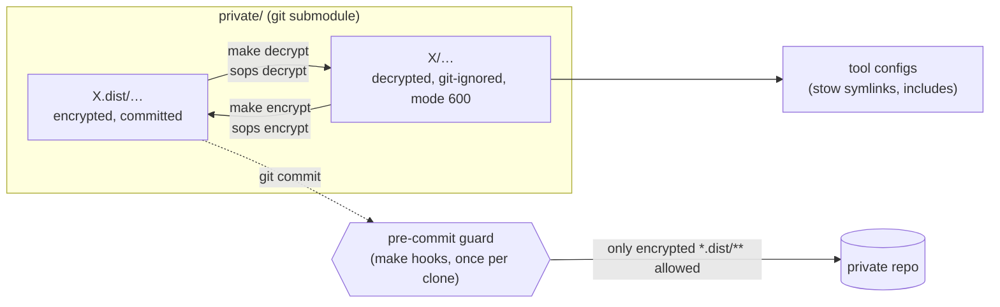
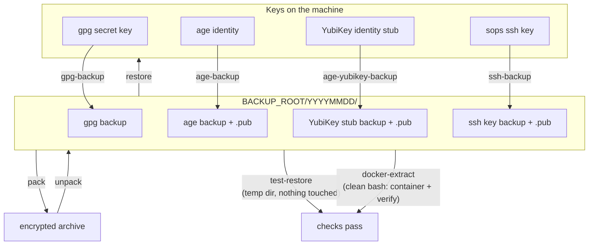
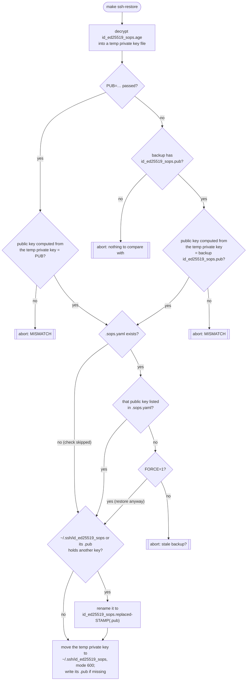

# Architecture

How secrets and key backups work.

## Secrets in `private/`

Secrets are tracked only sops-encrypted. Every top-level dir ending in `.dist`
holds the encrypted files; the same path without `.dist` holds the decrypted
copies, which are git-ignored. Tools never read the encrypted files: their
configs point at the decrypted copies.

| Piece | Role |
|---|---|
| `.sops.yaml` | creation rules and key groups for the encrypted files |
| `scripts/secrets.sh` | `encrypt` / `decrypt` / `hooks`; skips unchanged files, keeps newer local edits |
| `private/.gitignore` | allowlist: only `*.dist/**`, `.gitignore`, `.githooks/` |
| `private/.githooks/pre-commit` | refuses staged files outside `*.dist/` and plaintext inside it |

Unchanged detection uses mtimes: after every encrypt or decrypt, the decrypted
copy gets the encrypted file's mtime, so "edited" means "newer than its `.dist`".
That avoids decrypting (YubiKey touch + ssh key) just to compare.

## Key backups

The keys sops needs, each backed up passphrase-protected into
`BACKUP_ROOT/YYYYMMDD/`, optionally packed into one archive.

Every check compares the restored key with the `.pub` / fingerprints saved in
the same backup. Passing `PUB=` / `FPR=` adds the independent check against a
value you noted elsewhere; `ssh-restore` also checks `.sops.yaml`.

### ssh-restore decisions

`ssh-restore` answers two questions: is the backup the right key, and how to put
it in `~/.ssh` without destroying anything. `ssh-test-restore` runs the same flow
into a temp dir instead of `~/.ssh`.

#### Terminology

The chart uses the default names. They follow `SSH_KEY`, and `DEST=` picks
another target.

| Term | Meaning |
|---|---|
| `id_ed25519_sops.age` | the backup: the private key, encrypted with your passphrase |
| `id_ed25519_sops.pub` | stored next to the `.age` file at backup time: its public key |
| `PUB` | optional `make` variable: the public key you noted elsewhere, e.g. `PUB="ssh-ed25519 AAAA…"` |
| `FORCE=1` | restore even if `.sops.yaml` does not list the key |
| `STAMP` | restore time, `YYYYMMDD-HHMMSS` |

#### Flow

`PUB` comes from outside the backup, so it also catches a swapped backup; the
backup `.pub` only catches a mismatch inside the backup. Hence `PUB` wins when passed.

The public key is computed from the temp private key (`ssh-keygen -y`), in
memory only.

Every abort happens before anything in `~/.ssh` is touched. Renamed files are kept,
never deleted. The key and its `.pub` are checked one by one: an identical key
(byte compare, so no passphrase prompt) is left as it is.

### Code layout

`scripts/backup.sh` is the only entry point: settings, `parse_args`, `prepare`,
and dispatch of `<command>` to a `cmd_*` function. The work lives in modules:

| Module | Commands |
|---|---|
| `scripts/backup/common.sh` | helpers: argument checks, backup paths, `latest`, temp dir |
| `scripts/backup/gpg.sh` | `gpg-fingerprint`, `gpg-backup`, `gpg-test-restore`, `gpg-restore` |
| `scripts/backup/age.sh` | `age-backup`, `age-test-restore`, `age-restore` |
| `scripts/backup/yubikey.sh` | `age-yubikey-backup`, `age-yubikey-test-restore` |
| `scripts/backup/ssh.sh` | `ssh-backup`, `ssh-test-restore`, `ssh-restore` |
| `scripts/backup/verify.sh` | `verify` |
| `scripts/backup/pack.sh` | `pack`, `unpack`, `run`, `summary` |

`run` starts each command as a new process of `backup.sh` (`BACKUP_SCRIPT`), so
one failing command stops the run and every command gets a clean temp dir.
