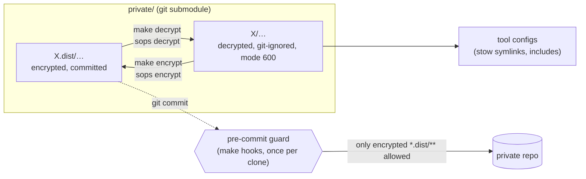
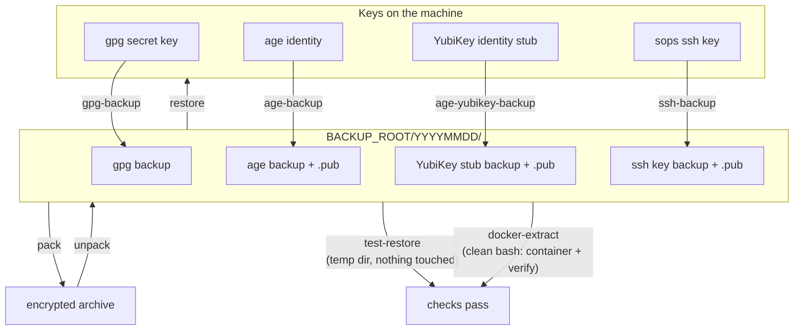
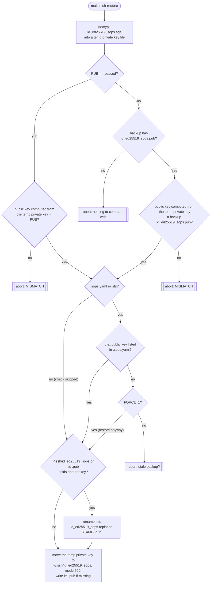
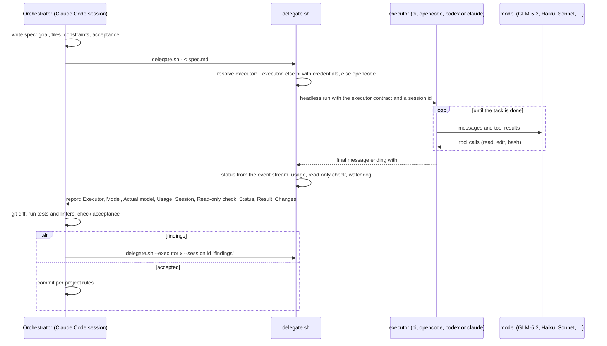
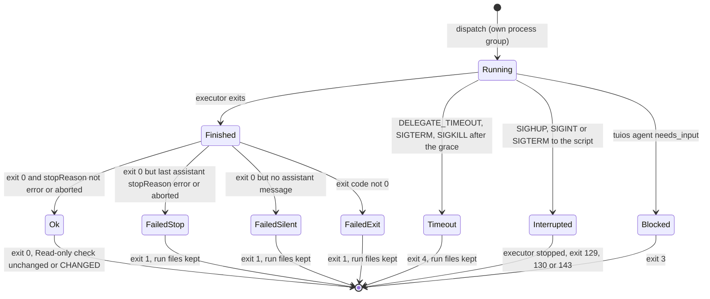
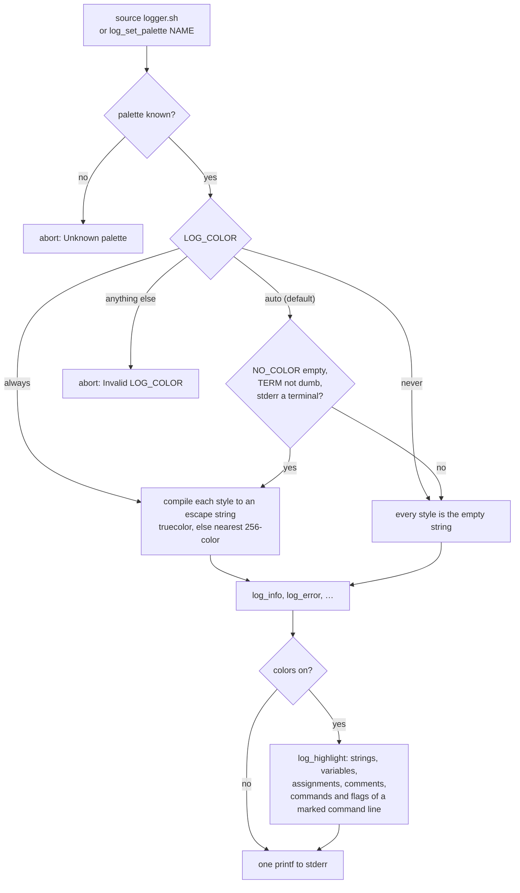

# Architecture

How secrets, key backups and model delegation work.

## Secrets in `private/`

Secrets are tracked only sops-encrypted. Every top-level dir ending in `.dist`
holds the encrypted files; the same path without `.dist` holds the decrypted
copies, which are git-ignored. Tools never read the encrypted files: their
configs point at the decrypted copies.

| Piece | Role |
|---|---|
| `.sops.yaml` | creation rules and key groups for the encrypted files |
| `scripts/secrets.sh` | `encrypt` / `decrypt` / `hooks`; skips files in sync, keeps newer local edits, stops when only you can decide |
| `private/.gitignore` | allowlist: only `*.dist/**`, `.gitignore`, `.githooks/` |
| `private/.githooks/pre-commit` | refuses staged files outside `*.dist/` and plaintext inside it |

### How `encrypt` and `decrypt` decide

Every secret exists twice: the encrypted version, which git tracks, and the readable decrypted version,
which git ignores. Neither command may silently overwrite a change in the other version, so
the script has to know which version changed.

Reading an encrypted file needs your keys (YubiKey touch + ssh key). To avoid that on every
run, the script gives both files the same file time when it finishes. On the next run the
times show what happened in between:

| Decrypted version | What happened | `make encrypt` | `make decrypt` |
|---|---|---|---|
| has the same time | nothing | skips the file | nothing to do |
| is newer | the decrypted version was edited| writes it into the encrypted version | keeps the edit |
| is older, same content | git rewrote the encrypted file (pull, checkout, reset), the secret is the same | nothing: both get the same time again | nothing: both get the same time again |
| is older, other content | git rewrote the encrypted file and the two versions disagree | stops on that file | stops on that file |
| is missing | new machine, or a new secret from git | - | writes the decrypted version |

The two "is older" rows are the one case where `make encrypt` needs the keys: the times
cannot tell whether the decrypted version is only outdated or holds an edit that was never
encrypted, so the script reads the encrypted file and compares.

A stop changes no file. The script names the file, finishes the other files and exits 1,
because only you know which version is right:

- to keep the decrypted version: `touch` it, then `make encrypt`
- to take the version from git: `FORCE=1 make decrypt`

## Key backups

The keys sops needs, each backed up passphrase-protected into
`BACKUP_ROOT/YYYYMMDD/`, optionally packed into one archive.

Every check compares the restored key with the `.pub` / fingerprints saved in
the same backup. Passing `PUB=` / `FPR=` adds the independent check against a
value you noted elsewhere; `ssh-restore` also checks `.sops.yaml`.

### ssh-restore decisions

`ssh-restore` answers two questions: is the backup the right key, and how to put
it in `~/.ssh` without destroying anything. `ssh-test-restore` runs the same flow
into a temp dir instead of `~/.ssh`.

#### Terminology

The chart uses the default names. They follow `SSH_KEY`, and `DEST=` picks
another target.

| Term | Meaning |
|---|---|
| `id_ed25519_sops.age` | the backup: the private key, encrypted with your passphrase |
| `id_ed25519_sops.pub` | stored next to the `.age` file at backup time: its public key |
| `PUB` | optional `make` variable: the public key you noted elsewhere, e.g. `PUB="ssh-ed25519 AAAA…"` |
| `FORCE=1` | restore even if `.sops.yaml` does not list the key |
| `STAMP` | restore time, `YYYYMMDD-HHMMSS` |

#### Flow

`PUB` comes from outside the backup, so it also catches a swapped backup; the
backup `.pub` only catches a mismatch inside the backup. Hence `PUB` wins when passed.

The public key is computed from the temp private key (`ssh-keygen -y`), in
memory only.

Every abort happens before anything in `~/.ssh` is touched. Renamed files are kept,
never deleted. The key and its `.pub` are checked one by one: an identical key
(byte compare, so no passphrase prompt) is left as it is.

### Code layout

`scripts/backup.sh` is the only entry point: settings, `parse_args`, `prepare`,
and dispatch of `<command>` to a `cmd_*` function. The work lives in modules:

| Module | Commands |
|---|---|
| `scripts/backup/common.sh` | helpers: argument checks, backup paths, `latest`, temp dir |
| `scripts/backup/gpg.sh` | `gpg-fingerprint`, `gpg-backup`, `gpg-test-restore`, `gpg-restore` |
| `scripts/backup/age.sh` | `age-backup`, `age-test-restore`, `age-restore` |
| `scripts/backup/yubikey.sh` | `age-yubikey-backup`, `age-yubikey-test-restore` |
| `scripts/backup/ssh.sh` | `ssh-backup`, `ssh-test-restore`, `ssh-restore` |
| `scripts/backup/verify.sh` | `verify` |
| `scripts/backup/pack.sh` | `pack`, `unpack`, `run`, `summary` |

`run` starts each command as a new process of `backup.sh` (`BACKUP_SCRIPT`), so
one failing command stops the run and every command gets a clean temp dir.

## Delegation: orchestrator and executor

The `delegate` skill (`harness/skills/delegation/`) splits a coding task across
two models. The Claude Code session (the orchestrator) writes the spec,
validates the result and decides. A cheaper model, driven by a headless coding
agent, edits and runs. The two never share a context window: the only channel
is the spec going down and a report coming up.

One interface, four executors:

| Executor | Headless run | Feedback round | Read-only | Contract |
|---|---|---|---|---|
| `pi` (default) | `pi -p --mode json --no-approve --session-id <id>` in a hermetic `PI_CODING_AGENT_DIR`, task on stdin | same id | `--tools read,grep,find,ls` | `--append-system-prompt <file>` |
| `opencode` (auto fallback) | `opencode run --standalone --auto --session <id>` | same id | `--agent plan` | ahead of the task |
| `codex` | `codex exec --json --output-last-message`; thread id from `thread.started` | `codex exec resume <thread> -c sandbox_mode=<mode>` | `-s read-only` | ahead of the task, on stdin |
| `claude` | `claude -p --session-id <uuid> --permission-mode acceptEdits`, `CLAUDE_QUIET=true` | `claude -p --resume <uuid>` | `--tools Read,Grep,Glob` | `--append-system-prompt <text>` |

Inside the Claude Code sandbox only `pi` runs: `opencode` needs a local
port, `codex` nests its own Seatbelt profile and writes `~/.codex`, `claude`
reads the AWS auth files. The other three run from an unsandboxed shell or
through the tuios transport.

`--via tuios` swaps the headless subprocess for an interactive agent in a
tuios pane: `tuios start-agent <executor> --name dlg-<id> --grants none`
opens it at its prompt, `tuios ask-agent -w dlg-<id>` types the task and
returns the reply once the agent is back at rest, and `tuios get-agent-state`
plus `tuios peek-prompt` turn a `needs_input` agent into exit status 3 with
the blocking prompt in the report. The pane lives in the user's terminal
session, outside the sandbox, so every executor works there and approval
dialogs are answered by the user. The auto chain ends here when neither `pi`
nor `opencode` is installed and a tuios daemon is running. tuios was chosen
over herdr because its `ask-agent` returns the reply as data instead of a
scrollback read, and tuios answers herdr's CLI anyway for tools built on it.

### ADR: a script and a skill, not a subagent

Context. Claude Code subagents can run on another Anthropic model, but not on
another vendor: one process has one endpoint and one credential. GLM has to run
as a separate process.

Decision. A self-contained Bash 3.2 script inside the skill directory drives
one of four headless executors behind one interface, `pi` first. The skill
tells the orchestrator how to spec, validate and iterate; the executor prompt
tells the model what to report. The orchestrator calls the script through
Bash, so dispatches can run in the background and in parallel on disjoint
file sets.

Alternatives considered:

| Option | Why not |
|---|---|
| Headless Claude Code on Z.ai's Anthropic-compatible endpoint | a second config dir and key wiring; Anthropic documents non-Claude routing as unsupported; the user chose Pi |
| OpenCode as executor | binds a local port even in standalone mode, which the sandbox refuses |
| A Haiku subagent wrapping the executor | an extra, lossy model hop; the script already bounds the output |
| An LLM gateway mapping an alias to GLM | the orchestrator's own traffic would cross the gateway, which would have to speak the AWS auth path |

Consequences. Pi runs with a relocated config dir (`DELEGATE_STATE_DIR/agent`),
offline startup, no extensions, MCP servers or skills, and the `ask_question`
tool excluded: a headless run cannot answer. Feedback rounds reuse the Pi
session by id, so the executor keeps its context. Credentials stay in the
environment (`ZAI_API_KEY`); the sandbox needs `api.z.ai` allowed, per Bash call
through `allowed_domains` or in `sandbox.network.allowedDomains`. The executor
acts without approval prompts, so the sandbox is the boundary, and the
orchestrator re-runs every check itself.

### ADR: the outcome is measured, not reported

Context. pi exits 0 after a provider failure: observed inside the sandbox with
`api.z.ai` denied, pi retried three times, emitted an assistant message with
`stopReason: "error"` and exited 0 with an empty stderr; in text mode it printed
nothing and did not exit for over an hour. An exit code is transport, not
content, and a tool allowlist is a promise, not proof that nothing was written.

Decision. Every signal the report carries is measured by the script:

pi runs in `--mode json`; `jq` reads the session id, the assistant text parts,
the last `stopReason` and `errorMessage`, and sums `usage` over the run. Lines
that are not JSON objects are skipped, and a stream without an assistant message
fails the round. The executor runs in its own process group (`set -m` around the
spawn), so a stuck tool command dies with it. The watchdog is a second job that
polls that group: at the limit it writes a marker, sends SIGTERM, and SIGKILL to
what is left after `DELEGATE_KILL_GRACE` seconds. A signal to the script stops
the group the same way; after a `kill -9` of the script the watchdog still
fires. `--read-only` hashes `git status --porcelain`, both diffs without the
user's diff drivers and the content of untracked files before and after the run;
a difference is `CHANGED`, a missing repository is `unknown`.

Alternatives considered:

| Option | Why not |
|---|---|
| Trust the exit code and the executor's `## Report` | the observed exit 0 after a failed run; the report is the executor's claim |
| A Node relay writing `result.json`, as in amElnagdy/delegate-skills | a second language in a Bash harness; the orchestrator reads Markdown as easily as JSON |
| GNU `timeout` or `setsid` for the watchdog | Homebrew-only on macOS; `set -m` is Bash 3.2 |
| Kill the executor PID only | leaves a hung tool command running after the report |
| A watchdog that sleeps through the whole limit | it cannot see that the group is gone and could signal a recycled group id later; a polling watchdog leaves with the group |

Consequences. `jq` is required for pi as it already was for codex. A read-only
`CHANGED` verdict is reported, not turned into an exit code: the skill tells the
orchestrator it fails the round. The event log lives in the run directory: a
successful run removes it, a failed run keeps it and names it in the report.
pi's own session file keeps the conversation for a feedback round. pi runs each
tool command in a process group of its own and stops it on SIGTERM, so a tool
command can outlive the run only when pi itself has to be killed with SIGKILL.

### Code layout

| File | Role |
|---|---|
| `harness/skills/delegation/SKILL.md` | the loop: spec, dispatch, validate, decide |
| `harness/skills/delegation/executor-prompt.md` | contract appended to the executor's system prompt |
| `harness/skills/delegation/scripts/delegate.sh` | executor resolution, direct and tuios transports, watchdog, read-only check, report, exit codes (0 ok, 1 failure, 2 usage, 3 blocked, 4 timeout, 129/130/143 after a signal) |
| `tests/delegate.bats`, `tests/mocks/{pi,opencode,codex,claude,tuios}` | coverage with stubbed executors and tuios on a PATH that hides the real ones |

## Logger: theme, colors, highlighting

`scripts/logger.sh` prints syslog-style lines to stderr: a prefix, a level tag
and the message. A theme table gives each of the three a palette role per
level; a palette maps roles to RGB values.

| Piece | Role |
|---|---|
| `LOG_THEME_LEVELS` | one row per level: palette roles of the prefix, the tag (bold) and the message |
| `LOG_THEME_SYNTAX` | one palette role per token kind: string, variable, assignment, comment, command, flag |
| `LOG_SYNTAX_TOKENS` | one ERE alternative per token kind, each `(<boundary>)(<token>)` |
| `LOG_CODE` | the marker a caller puts around a command line; a control character, never printed |
| `LOG_SYNTAX_PATTERN` | a message, which is prose: the tokens, plus the text between two `LOG_CODE` markers |
| `LOG_COMMAND_PATTERN` | that text, which is a command line: the tokens, plus command words and flags |
| `RGB_<palette>_<role>` | palettes; `default` holds every role, a scheme (`LOG_PALETTE`) overrides the roles it names |
| `LOG_SGR_*` | the compiled styles, empty when colors are off |
